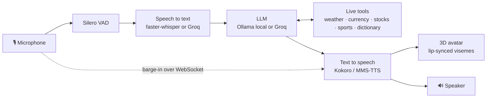

# Avatar AI — a private voice assistant with a 3D avatar

**Talk to it naturally, interrupt it any time, and keep your conversations on your own machine.**

Avatar AI (code name *Krishna*) is a voice assistant that listens, thinks and speaks entirely on your computer by default. A 3D avatar lip-syncs every reply, it answers time-sensitive questions with live data, and an optional fast cloud mode tells you exactly what leaves the machine before anything does.

<p align="center">
  
  
  
</p>
<p align="center"><sub>Some of the photo backgrounds the avatar can stand in front of (credits in <a href="static/avatar/backgrounds/ATTRIBUTION.md">ATTRIBUTION.md</a>).</sub></p>

---

## What it does

| | |
|---|---|
| 🎙️ **Hands-free conversation** | Voice-activity detection (Silero VAD) starts and stops recording on its own; no buttons mid-sentence. |
| ✋ **True barge-in** | Interrupt it while it's talking. A FastAPI + WebSocket server keeps audio flowing both ways, so it stops and listens. |
| 🧑‍🎤 **3D avatar with lip-sync** | Six avatar models on the TalkingHead (three.js) engine; mouth shapes (visemes) are timed from the speech itself, in front of photo backgrounds. |
| 🌐 **Live answers, not stale memory** | LLM function calling fetches real data mid-conversation: weather, currency conversion, word definitions, stock prices, sports scores (and jokes). |
| 🗣️ **Multilingual** | Auto-detects English, Hindi or Telugu, and replies in a matching voice; understands Telugu or Hindi typed in English letters ("ela unnav"). |
| 🧠 **Remembers you** | Keeps conversation history and notes locally between sessions. |

## Privacy by design

| Mode | Speech-to-text | Brain | Voice | What leaves your machine |
|---|---|---|---|---|
| **Local (default)** | faster-whisper | Ollama `llama3.2:3b` | Kokoro / MMS-TTS | **Nothing** |
| **Fast (opt-in)** | Groq `whisper-large-v3-turbo` | Groq `gpt-oss-120b` | Kokoro / MMS-TTS (local) | Your audio and the conversation text, sent to Groq. The UI says so before you switch. |

The trade-off is stated plainly: the local 3B model is private but slower and weaker on Telugu typed in English letters; fast mode is quick and fluent but is a cloud call. You choose, per session.

## How it works



| File | Role |
|---|---|
| `krishna.py` | The brain: recording, transcription, language detection, LLM + tool calls, speech synthesis, viseme timing |
| `server.py` | FastAPI + WebSocket live server with true barge-in |
| `app.py` | Streamlit UI: chat history, voice and avatar settings, local/fast switch |
| `tools.py` | Live-data tools the model can call (plain Python functions with docstrings) |
| `static/avatar/` | 3D avatar models, lip-sync and audio worklets, photo backgrounds |

## Run it

```bash
python -m venv venv && venv\Scripts\activate      # Windows
pip install faster-whisper ollama kokoro sounddevice webrtcvad numpy fastapi uvicorn streamlit requests
ollama pull llama3.2:3b                            # local brain
```

- **Live server with avatar and barge-in:** `Krishna Live.bat` (or `python server.py`)
- **Streamlit app:** `run_krishna.bat` (or `streamlit run app.py`)
- **Console:** `Krishna.bat` (or `python krishna.py`)

Optional keys go in `api_keys.env` (git-ignored): `GROQ_API_KEY` for fast mode, plus any keys the live tools use.

## Built with

Python · Ollama · faster-whisper · Silero VAD · Kokoro TTS · MMS-TTS · Groq · FastAPI · WebSockets · Streamlit · TalkingHead / three.js 3D avatar (GLB) · LLM function calling

---

Designed and built by **Srinivasa Rao Somu** with AI-assisted development · [GitHub](https://github.com/somu-analyst) · [LinkedIn](https://www.linkedin.com/in/srinivasaraosomu/)
